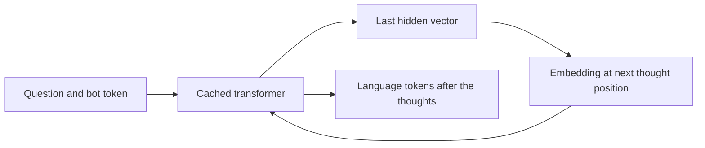

# Continuous thoughts in a small transformer

This implementation asks a narrow question: can a small transformer carry intermediate arithmetic values in hidden states instead of writing them as tokens? It implements the feedback mechanism from [Hao et al., *Training Large Language Models to Reason in a Continuous Latent Space*](https://arxiv.org/abs/2412.06769), using a three-layer, 64-dimensional model trained from scratch on synthetic arithmetic. It does not test the paper's larger language-model benchmarks.

The links below pin the original complete implementation at [`ee110b9`](https://github.com/bushesarebetter/coconut-latent-reasoning/tree/ee110b907541a290e1aeb09e0fd78bcb09c84979). This is an explanation of that code and its existing tests. It does not introduce a new training run or an ablation study.

## A task with known intermediate values

Each question assigns an initial digit to a variable, then applies four operations modulo 10. Variable names change between questions. The generator returns the question, three intermediate values, and the final answer. An independent test evaluator checks 300 examples each at one, four, and six operations. See the [generator and sequence builder](https://github.com/bushesarebetter/coconut-latent-reasoning/blob/ee110b907541a290e1aeb09e0fd78bcb09c84979/coconut.py#L17-L49) and [arithmetic tests](https://github.com/bushesarebetter/coconut-latent-reasoning/blob/ee110b907541a290e1aeb09e0fd78bcb09c84979/test_coconut.py#L10-L30).

```text
question:  k = 7 ; q = k * 3 ; b = q + 8 ; x = b - 4 ; m = x * 6 ; ? m
CoT:       <bot> 1 9 5 <eot> # 0 <eos>
Coconut:   <bot> [h] [h] [h] <eot> # 0 <eos>
```

Language CoT writes the intermediate values. At curriculum stage `k`, Coconut replaces the first `k` values with `k` continuous thoughts. Remaining written values stay before `<eot>`. Stage zero is therefore the language CoT sequence, while stage three contains no written intermediate values.

## What actually enters a latent slot

The `<lat>` token marks a position in the sequence, but its embedding is not the thought. `run()` first processes the question and `<bot>`. It takes the last hidden vector from that prefix and passes it directly to `GPT.hidden()` as the embedding at the next position. The next thought uses the hidden vector produced at that new position. See the [feedback loop](https://github.com/bushesarebetter/coconut-latent-reasoning/blob/ee110b907541a290e1aeb09e0fd78bcb09c84979/coconut.py#L95-L115).



The fed-back vector is the output after the model's final LayerNorm. `GPT.hidden()` adds the positional embedding for its new position before passing it through the blocks. There is no token decoding between thoughts, and the loop does not detach the vectors from the gradient graph. The implementation is in [`GPT.hidden()`](https://github.com/bushesarebetter/coconut-latent-reasoning/blob/ee110b907541a290e1aeb09e0fd78bcb09c84979/coconut.py#L72-L92).

The tests check this mechanism directly. For each latent slot, they recompute the preceding prefix without the cache and compare its final hidden vector with the vector inserted into that slot. They also check that thoughts differ between questions and are not simply rows from the token embedding table. See [the latent-slot test](https://github.com/bushesarebetter/coconut-latent-reasoning/blob/ee110b907541a290e1aeb09e0fd78bcb09c84979/test_coconut.py#L33-L54).

## Cache positions and causality

Each attention block appends new keys and values to its cached prefix. Its causal mask uses an offset of `S - T`, where `S` is the total key length and `T` is the length of the new chunk. This lets new positions attend to the prefix and to earlier positions in the same chunk. Positional embeddings begin at the cached prefix length, rather than restarting at zero. See [attention and cache handling](https://github.com/bushesarebetter/coconut-latent-reasoning/blob/ee110b907541a290e1aeb09e0fd78bcb09c84979/coconut.py#L60-L92).

The latent-slot test compares the cached sequential result with one uncached pass over the same constructed input vectors, within an absolute tolerance of `1e-5`. That tests forward-value agreement. It does not establish full gradient equivalence between every cached and uncached computation.

## Learning through the thoughts

Cross-entropy supervises the language tokens left after the prompt: remaining intermediate values, `<eot>`, `#`, the answer, and `<eos>`. There is no target vector for a continuous thought. Its useful content must be learned through its effect on subsequent predictions. The loss slice is defined in [the training loop](https://github.com/bushesarebetter/coconut-latent-reasoning/blob/ee110b907541a290e1aeb09e0fd78bcb09c84979/coconut.py#L118-L135).

A separate test backpropagates through the latent pass. The unused `<lat>` embedding receives zero gradient, while a question-token embedding receives a nonzero gradient. This checks that the placeholder is bypassed and that the question remains connected to the computation. See [the gradient test](https://github.com/bushesarebetter/coconut-latent-reasoning/blob/ee110b907541a290e1aeb09e0fd78bcb09c84979/test_coconut.py#L57-L65).

## Curriculum and comparison budget

The full run allocates 4000 optimizer steps to each final variant. Coconut starts from a copy of the language CoT model after 1000 steps, then receives 1000 steps at each of three curriculum stages. The language model receives its remaining 3000 steps separately. The direct-answer model trains for 4000 steps. Each stage creates a fresh optimizer. See [the experiment driver](https://github.com/bushesarebetter/coconut-latent-reasoning/blob/ee110b907541a290e1aeb09e0fd78bcb09c84979/coconut.py#L161-L197) and [optimizer creation](https://github.com/bushesarebetter/coconut-latent-reasoning/blob/ee110b907541a290e1aeb09e0fd78bcb09c84979/coconut.py#L118-L122).

Equal optimizer steps do not mean equal computation. Thoughts require sequential transformer calls, and written sequences have different lengths. Coconut and language CoT share the stage-zero checkpoint; all three variants do not start from identical weights.

## Recorded results and changes from the paper

The existing README reports 16.2% accuracy for direct answers, 100.0% for language CoT, and 99.7% for the final Coconut stage, evaluated on 1000 fresh problems. It reports 3.0, 7.0, and 4.0 output tokens respectively. These are the repository's recorded single-run results, not a new multi-seed replication. The [original report](https://github.com/bushesarebetter/coconut-latent-reasoning/blob/ee110b907541a290e1aeb09e0fd78bcb09c84979/README.md#L32-L47) also records two implementation changes:

- During intermediate curriculum stages, remaining written values precede `<eot>`. This keeps replacement positions aligned with stage-zero CoT.
- Positional embeddings keep PyTorch's default `N(0, 1)` initialization. The report says that with GPT-2's smaller `0.02` initialization, fed-back vectors overwhelmed the position signal and the third thought did not learn in those runs. The [source comment](https://github.com/bushesarebetter/coconut-latent-reasoning/blob/ee110b907541a290e1aeb09e0fd78bcb09c84979/coconut.py#L80-L81) records the same issue. No saved ablation establishes its frequency or effect size.

## What the measurements leave open

Evaluation greedily decodes 16 positions for every example. The reported token count is then truncated at the first `<eos>`, including that token. The implementation does not stop computation when an example reaches `<eos>`. Consequently, the lower output-token count does not establish a measured runtime saving. See [the evaluator](https://github.com/bushesarebetter/coconut-latent-reasoning/blob/ee110b907541a290e1aeb09e0fd78bcb09c84979/coconut.py#L138-L158).

The tests establish arithmetic consistency and several properties of hidden-state feedback. They do not establish what every hidden vector represents, that the model searches a branching space, or that the result transfers to natural-language problems. A new multi-seed comparison with matched initialization and measured computation would be a separate experiment.
